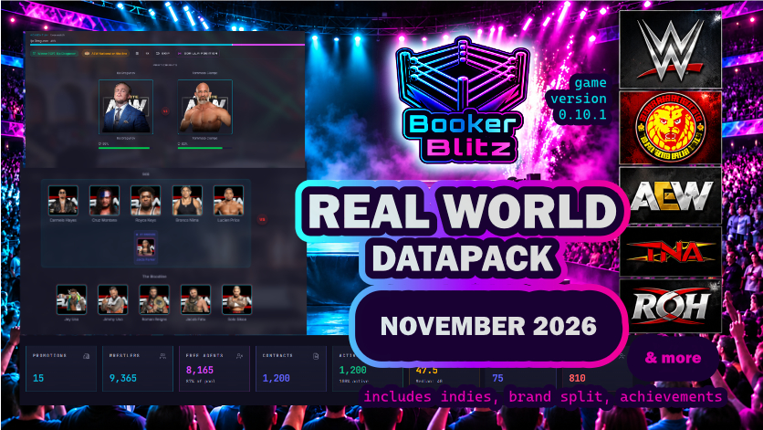

# Real World Datapack - November 2026

A real-world November 2026 snapshot for Booker Blitz.

15 promotions, 9,365 people, 1,200 signed contracts, 8,165 free agents. Built for playing the Monday night wars with real rosters, real staff, and real title / show structures.

[Images 🔻](https://www.mediafire.com/file/doqfrfek4rcpka4/RWNov26.zip/file)

## Stats

- **Promotions:** 15
- **Wrestlers / personnel:** 9,365
- **Free agents:** 8,165 (87% of pool)
- **Contracts:** 1,200
- **Active:** 1,200 (100% active)
- **Avg ability:** 47.5 (Median: 40)
- **In dev:** 75
- **Retired:** 810

## Contents

- **promotions.json** - 15 promotions, each with weekly shows, PPVs, titles, tag teams and signed staff
- **wrestlers.json** - 9,365 people: 7,769 wrestlers, 1,200 signed, 8,165 free agents
- **indies.json** - 10 indies
- **alliances.json** - 4 alliances

### Roster by promotion

| id | Promotion | Lvl | Signed workers |
|---:|---|---:|---:|
| 1 | TNA | 4 | 72 |
| 2 | WWE | 9 | 176 |
| 3 | NXT | 4 | 104 |
| 5 | ROH | 4 | 50 |
| 21 | AAA | 6 | 53 |
| 22 | CMLL | 8 | 123 |
| 23 | AJPW | 6 | 36 |
| 24 | NJPW | 8 | 76 |
| 25 | NOAH | 4 | 47 |
| 26 | Dragongate | 5 | 57 |
| 37 | DDT | 5 | 49 |
| 49 | Stardom | 4 | 41 |
| 58 | BJW | 4 | 61 |
| 338 | AEW | 6 | 185 |
| 353 | NWA | 4 | 71 |

### Staff ecosystem - 380 assigned keyStaff slots

Owner 12, GM 7, Booker 11, Writers 36, Interviewer 23, Ring Announcers 36, Commentators 77, Referees 85, Medic Team 20, Scouts 15, Road Agents 42, Trainers 16.

By personnel type (`wrestler.type`, 9,365 total):

Wrestler 7,769, Manager 165, Commentator 159, Interviewer 20, Ring Announcer 48, Referee 320, Writer 433, Businessperson 27, Medic 42, Scout 122, Trainer 268.

## Image sources

**The `.bbdb` embeds no images.** `picture`, `logo` and staff `pic` fields are filenames only (`CM Punk.png`, `WWE_alt1.png`). Download the `RWNov26` image pack from MediaFire (the only image host for this pack), extract it, and point DataStudio's datapack import at the extracted image folder.

- Image host: MediaFire `RWNov26.zip` (same pack as Real World November 2026)
- Images are not embedded in the `.bbdb`; `picture` and `logo` fields are filenames that resolve against the host.

Found a missing / wrong portrait or logo in the image pack? Report it on the reddit thread so it can get fixed in the next pack update.

## Real names

Wrestler, staff and promotion names are real and are used descriptively. No real promotion logo or trademarked artwork is included in this repository.
